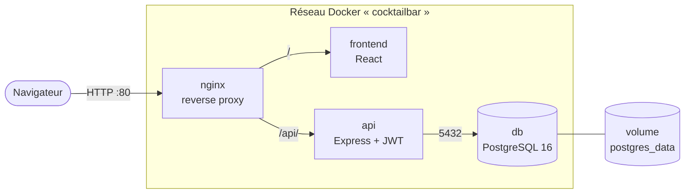

# Cocktail Bar

[](https://github.com/thomaspeyr31/cocktail-bar/actions/workflows/ci.yml)

🇬🇧 [English version](README.md)

Gestion des commandes d'un bar à cocktails : une API REST avec authentification JWT et gestion des rôles, une interface React et une base PostgreSQL, conteneurisées et orchestrées avec Docker Compose derrière un point d'entrée Nginx unique.

Projet en binôme, Bachelor 2 à Ynov Toulouse. J'ai réalisé **l'API, la conteneurisation et l'orchestration** ; l'interface React a été développée par mon binôme et se trouve dans [son dépôt](https://github.com/Spartansng/cocktail-bar-frontend).

## Architecture



| Conteneur | Image | Port | Rôle |
|-----------|-------|------|------|
| nginx | `nginx:alpine` | 80 → 80 | Reverse proxy, seul point d'entrée |
| api | build de [`backend/`](backend) | 3000 (interne) | API REST Express |
| frontend | build du [dépôt frontend](https://github.com/Spartansng/cocktail-bar-frontend) | 80 (interne) | Interface React |
| db | `postgres:16-alpine` | 5432 (interne) | Base de données |

## Choix de sécurité

- **Un seul port exposé** : seul Nginx publie un port ; l'API et la base ne sont joignables que sur le réseau Docker interne.
- **Aucun secret dans le code** : mot de passe de la base et clé JWT dans un `.env` non versionné (modèle : [`.env.example`](.env.example)).
- **Image de l'API durcie** : build multi-étapes, dépendances de production uniquement, exécution sans root.
- **Mots de passe hachés avec bcrypt**, JWT avec rôles (`user`, `staff`, `admin`) vérifiés par middleware, validation des entrées à la connexion et à la création de compte.
- **Démarrage contrôlé** : l'API attend le healthcheck de PostgreSQL.

## Lancement

```bash
git clone https://github.com/thomaspeyr31/cocktail-bar.git
cd cocktail-bar
cp .env.example .env      # puis remplacer les valeurs par défaut
docker compose up --build
```

Ouvrir <http://localhost>. Compose construit le frontend directement depuis son dépôt Git : rien d'autre à cloner.

Compte de démonstration (local uniquement) : `admin2024` / `Admin2024!@#$`.

## API

| Méthode | Route | Accès | Description |
|---------|-------|-------|-------------|
| POST | `/api/auth/login` | Public | Connexion, retourne un JWT |
| GET | `/api/cocktails` | Public | Liste (filtres : `ingredient`, `category`, `search`) |
| GET | `/api/cocktails/:id` | Public | Détail |
| POST / PUT / PATCH / DELETE | `/api/cocktails[/:id]` | Admin | Gestion de la carte |
| GET | `/api/orders` | Public | Liste (filtres : `status`, `table`) |
| POST | `/api/orders` | Public | Passer une commande |
| PUT / DELETE | `/api/orders/:id` | Staff+ | Changer le statut / supprimer |
| GET / POST / PUT / DELETE | `/api/users[/:id]` | Admin | Gestion des utilisateurs et des rôles |

## Tests et CI

18 tests d'intégration (Jest + Supertest) exécutés sur une vraie base PostgreSQL. À chaque push, GitHub Actions lance les tests, valide le fichier Compose et construit l'image de l'API.

```bash
cd backend
npm ci
npm test   # nécessite PostgreSQL, voir .github/workflows/ci.yml
```

## Organisation du dépôt

```
.
├── backend/              API Express : routes, contrôleurs, middleware JWT, tests, Dockerfile
├── db/                   Schéma et données chargés au premier démarrage
├── nginx/default.conf    Configuration du reverse proxy
├── docker-compose.yml    Orchestration des 4 services
└── documentation_conteneurisation.pdf   Rapport de conteneurisation
```

## Équipe

| Nom | Rôle |
|-----|------|
| Thomas Peyrusaubes | API, conteneurisation, orchestration |
| Lorenzo Sinigaglia | Frontend |
