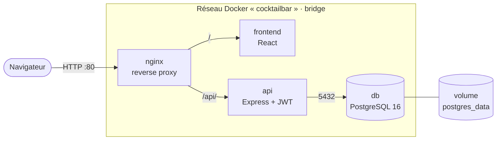

# Cocktail Bar — orchestration Docker

Application de gestion des commandes d'un bar à cocktails, découpée en services
conteneurisés et orchestrée avec Docker Compose. Ce dépôt réunit l'orchestration :
Compose, reverse proxy Nginx et initialisation de la base de données.

Projet réalisé en binôme à Ynov Toulouse (B2).

## Dépôts du projet

| Dépôt | Contenu |
|-------|---------|
| [cocktail-bar](https://github.com/thomaspeyr31/cocktail-bar) | Orchestration : Docker Compose, Nginx, scripts SQL (ce dépôt) |
| [cocktail-bar-backend](https://github.com/thomaspeyr31/cocktail-bar-backend) | API REST Express, authentification JWT, tests Jest, Dockerfile, CI |
| [cocktail-bar-frontend](https://github.com/Spartansng/cocktail-bar-frontend) | Interface React (Vite), servie par Nginx |

## Architecture



| Conteneur | Image | Port | Rôle |
|-----------|-------|------|------|
| nginx | `nginx:alpine` | 80 → 80 | Reverse proxy, seul point d'entrée |
| api | build de `cocktail-bar-backend` | 3000 (interne) | API REST Express |
| frontend | build de `cocktail-bar-frontend` | 80 (interne) | Interface React |
| db | `postgres:16-alpine` | 5432 (interne) | Base de données |

## Choix de sécurité

- **Un seul port exposé** : seul Nginx publie un port sur l'hôte ; l'API et la base ne sont joignables que sur le réseau Docker interne.
- **Secrets hors du code** : mot de passe de base et clé JWT passés par un fichier `.env` non versionné (modèle : `.env.example`).
- **Images officielles** en variante Alpine, plus légères et avec moins de surface d'attaque.
- **Démarrage contrôlé** : l'API attend que PostgreSQL réponde à son healthcheck avant de démarrer.
- **Données persistantes** dans un volume nommé, séparé des conteneurs.

## Lancement en local

Les images `api` et `frontend` sont construites depuis les deux autres dépôts,
qui doivent être clonés **dans le même dossier parent** :

```bash
git clone https://github.com/thomaspeyr31/cocktail-bar.git
git clone https://github.com/thomaspeyr31/cocktail-bar-backend.git
git clone https://github.com/Spartansng/cocktail-bar-frontend.git

cd cocktail-bar
cp .env.example .env    # puis remplacez les valeurs par défaut
docker compose up --build
```

L'application est accessible sur <http://localhost>.

## Variables d'environnement

| Variable | Valeur d'exemple | Description |
|----------|------------------|-------------|
| `DB_PASSWORD` | `postgres` | Mot de passe PostgreSQL |
| `JWT_SECRET` | `change-me-in-production` | Clé de signature des jetons JWT |

Ces valeurs d'exemple servent uniquement en local : générez des valeurs fortes
pour tout déploiement (`openssl rand -hex 32`).

## Compte de démonstration

Pour tester en local uniquement :

- **Identifiant** : `admin2024`
- **Mot de passe** : `Admin2024!@#$`

À changer immédiatement sur toute instance accessible depuis Internet.

## Documentation

Les choix de conteneurisation et d'architecture sont détaillés dans
[documentation_conteneurisation.pdf](documentation_conteneurisation.pdf).

## Équipe

| Nom | Rôle |
|-----|------|
| Thomas Peyrusaubes | Backend, conteneurisation, orchestration |
| Lorenzo Sinigaglia | Frontend |
