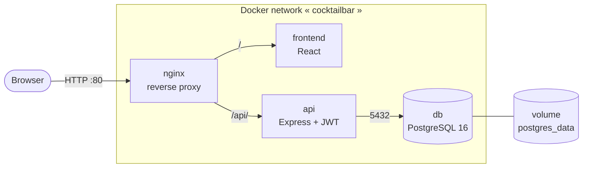

# Cocktail Bar

[](https://github.com/thomaspeyr31/cocktail-bar/actions/workflows/ci.yml)


🇫🇷 [Version française](README.fr.md)

Order management for a cocktail bar: a REST API with JWT authentication and role-based access, a React front end, and a PostgreSQL database — containerized and orchestrated with Docker Compose behind a single Nginx entry point.

Two-person project, Bachelor year 2 at Ynov Toulouse. I built the **API, the containerization and the orchestration**; the React front end was built by my teammate and lives in [his repository](https://github.com/Spartansng/cocktail-bar-frontend).

## Architecture



| Container | Image | Port | Role |
|-----------|-------|------|------|
| nginx | `nginx:alpine` | 80 → 80 | Reverse proxy, the only public entry point |
| api | built from [`backend/`](backend) | 3000 (internal) | Express REST API |
| frontend | built from the [front-end repo](https://github.com/Spartansng/cocktail-bar-frontend) | 80 (internal) | React interface |
| db | `postgres:16-alpine` | 5432 (internal) | Database |

## Security choices

- **One exposed port**: only Nginx publishes a port; the API and the database are reachable only on the internal Docker network.
- **No secrets in code**: database password and JWT key come from an untracked `.env` file (template: [`.env.example`](.env.example)).
- **Hardened API image**: multi-stage build, production dependencies only, runs as a non-root user.
- **Passwords hashed with bcrypt**, JWT with roles (`user`, `staff`, `admin`) checked by middleware, input validation on login and account creation.
- **Controlled startup**: the API waits for PostgreSQL's healthcheck before starting.

## Quick start

```bash
git clone https://github.com/thomaspeyr31/cocktail-bar.git
cd cocktail-bar
cp .env.example .env      # then replace the default values
docker compose up --build
```

Open <http://localhost>. Compose builds the front end directly from its Git repository, so nothing else needs to be cloned.

Demo account (local use only): `admin2024` / `Admin2024!@#$`.

## API

| Method | Route | Access | Description |
|--------|-------|--------|-------------|
| POST | `/api/auth/login` | Public | Log in, returns a JWT |
| GET | `/api/cocktails` | Public | List (filters: `ingredient`, `category`, `search`) |
| GET | `/api/cocktails/:id` | Public | Details |
| POST / PUT / PATCH / DELETE | `/api/cocktails[/:id]` | Admin | Manage the menu |
| GET | `/api/orders` | Public | List (filters: `status`, `table`) |
| POST | `/api/orders` | Public | Place an order |
| PUT / DELETE | `/api/orders/:id` | Staff+ | Update status / remove |
| GET / POST / PUT / DELETE | `/api/users[/:id]` | Admin | Manage users and roles |

## Tests and CI

18 integration tests (Jest + Supertest) run against a real PostgreSQL database. On every push, GitHub Actions runs the tests, validates the Compose file and builds the API image.

```bash
cd backend
npm ci
npm test   # needs a PostgreSQL instance, see .github/workflows/ci.yml
```

## Project layout

```
.
├── backend/              Express API: routes, controllers, JWT middleware, tests, Dockerfile
├── db/                   Schema and seed data loaded at first start
├── nginx/default.conf    Reverse proxy configuration
├── docker-compose.yml    Orchestration of the 4 services
└── documentation_conteneurisation.pdf   Containerization report (French)
```

## Team

| Name | Role |
|------|------|
| Thomas Peyrusaubes | API, containerization, orchestration |
| Lorenzo Sinigaglia | Front end |
